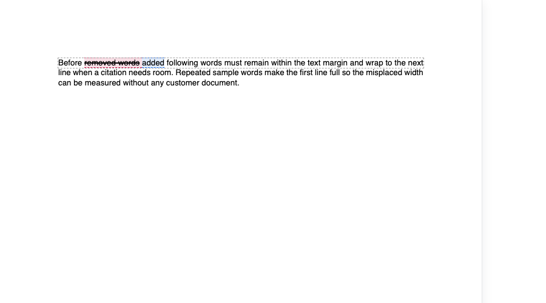
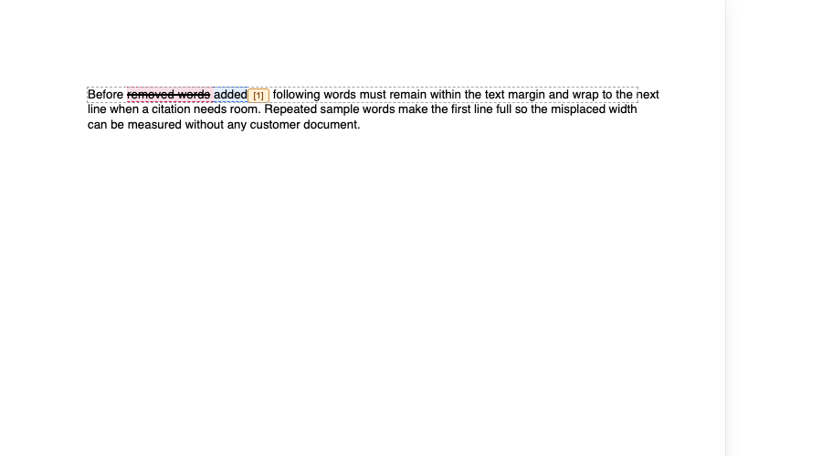
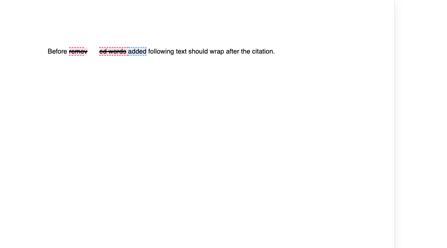

# Citation margin overflow and native-spacing blocker

Two distinct reproductions using **SuperDoc 2.24.0** in Chromium. Both use hand-authored synthetic DOCX files; no customer documents or application source are included.

| Case | What it reproduces | Ownership |
| --- | --- | --- |
| **A. Original margin overflow** | Adding an inline citation after SuperDoc has laid out a line pushes following text into the margin. | Application integration: the citation width was not included in SuperDoc's layout. |
| **B. Native-spacing blocker** | Attempting to reserve width using `ctx.visuals.inlineBox()` puts the gap inside earlier deleted text. | Suspected SuperDoc coordinate/painting defect; internal cause unconfirmed. |

**Case B is not the original overflow.** It is a separate problem encountered while trying to fix Case A through native line wrapping. This repo does not claim that bare SuperDoc text overflows, or that correcting Case B alone automatically fixes an application's citation integration.

## Run

Requires Node.js and npm.

```sh
npm install
npx playwright install chromium
npm run test:overflow
npm run test:spacing
```

`npm test` runs both cases. **Both tests deliberately fail against the behaviour being reported.** A failure to load the editor, or a different assertion failure, is not a successful reproduction.

## A. Original margin overflow

`margin-overflow.docx` has a justified paragraph containing a tracked replacement followed by enough synthetic text to fill a line.

1. Load it in SuperDoc with tracked changes visible in review mode.
2. Measure the right edge of the line's text and verify it fits within the line's text-area boundary.
3. Insert a 24 px citation marker (`[1]`) into the painted DOM immediately after the insertion. This models the application's existing post-layout citation integration; it does **not** call the native spacing API.
4. Measure the following text again.

### Expected behaviour

The citation's width should participate in document layout. The citation stays beside its owning text, and following words wrap onto the next line within the document's text margins. No citation should disappear or be moved elsewhere to avoid overflow.

### Actual behaviour

The original line breaks remain unchanged. Adding the marker pushes following text beyond the text-area boundary and into the page margin.

The test first checks that bare SuperDoc text fits, then fails on the overflow after insertion. The dashed outline in the screenshots marks the text line's layout box; it is paint-only and does not change layout. **The boundary is the text margin, not the outside edge of the paper.**

Before the application-added marker:



After the application-added marker:



Running the test writes fresh `margin-before.png` and `margin-after.png` screenshots and logs `MARGIN_OVERFLOW` with before/after measurements.

## B. Native-spacing blocker

`synthetic.docx` reads:

`Before [deleted: removed words ] [inserted: added] following text should wrap after the citation.`

1. Read the insertion using `ctx.doc.trackChanges.get({ id: "imported:102" })`.
2. The Document API returns insertion offsets **7–12**.
3. Target its final character (**11–12**) using `ctx.visuals.inlineBox()` with `gapAfter: 24`.

### Expected behaviour

The 24 px gap appears immediately after the final **d** in inserted `added`. It participates in line wrapping so a citation can remain beside the owning text without pushing following words past the margin. Earlier deleted text remains intact, without a new gap inside it.

### Actual behaviour

The gap appears after **v** in deleted `removed words`. The assertion fails with `expected 'v' to be 'd'`.

This appears to be a mismatch between visible coordinates returned by the Document API and coordinates used to paint the box in review mode. The internal cause is unconfirmed.



Running the test writes a fresh `synthetic-gap.png` screenshot.

## Contents

- `margin-overflow.docx`, `margin-overflow.browser.test.ts`: original overflow mechanism, reduced to a DOM-inserted citation with no application dependencies.
- `synthetic.docx`, `spacing.browser.test.ts`: native-spacing blocker.
- `vitest.config.ts`: Chromium test configuration.

SuperDoc is downloaded from npm and is not vendored here. Its own licensing terms apply.
